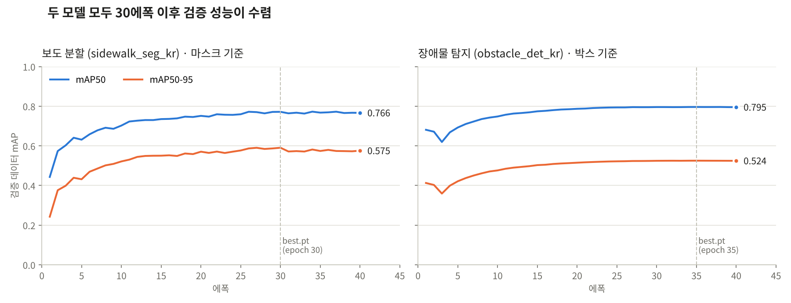

# RoadPush AI · 모델 학습 자료

RoadPush는 **YOLOv8 모델 2개**로 보행 영상을 분석합니다. 하나는 걸을 수 있는 보도 영역을 픽셀 단위로 나누고(분할), 다른 하나는 보도 위 보행 방해물을 찾습니다(탐지). 두 모델 모두 AI Hub '인도 보행 영상' 데이터로 직접 학습했습니다.

| 모델 | 용도 | 기반 모델 | 검증 mAP50 | 검증 mAP50-95 |
| --- | --- | --- | --- | --- |
| `sidewalk_seg_kr` | 보도·차도·자전거도로·주의구역 분할 | YOLOv8m-seg | 0.771 (마스크) | 0.590 (마스크) |
| `obstacle_det_kr` | 보행 방해물 5종 탐지 | YOLOv8m | 0.796 | 0.525 |

수치는 검증 성능이 가장 높았던 에폭(`best.pt`로 저장된 시점)의 값입니다. 보도 분할은 30에폭, 장애물 탐지는 35에폭입니다.

학습된 가중치는 실행 프로그램 폴더에 있습니다: `roadpush_app/detecting_ai/roadpush_weights/<모델명>/weights/best.pt`

## 폴더 구성

```
roadpush_ai/
├─ README.md                       이 문서
├─ training/
│  ├─ train_sidewalk_seg.py        서피스마스킹 XML → YOLO-seg 변환 + 보도 분할 학습
│  └─ train_obstacle_yolo.py       바운딩박스 XML → YOLO 변환 + 장애물 탐지 학습
├─ configs/
│  ├─ args_sidewalk_seg.yaml       보도 분할 학습 설정 (Ultralytics 자동 저장본)
│  └─ args_obstacle_det.yaml       장애물 탐지 학습 설정
└─ results/
   ├─ results_sidewalk_seg.csv     에폭별 손실·정밀도·재현율·mAP
   ├─ results_obstacle_det.csv
   └─ learning_curves.png          두 모델의 검증 mAP 변화
```

## 1. 학습 데이터

**출처:** AI Hub(aihub.or.kr) '인도 보행 영상' 데이터셋. 보행자 시점에서 촬영한 국내 인도 이미지와 라벨로 구성되어 있습니다.

| 하위 데이터 | 라벨 형식 | 사용한 모델 |
| --- | --- | --- |
| 서피스마스킹 (Surface) | 폴리곤 (CVAT XML) | 보도 분할 |
| 바운딩박스 (Bbox) | 사각형 박스 (CVAT XML) | 장애물 탐지 |

원본 전체는 하위 데이터마다 압축 파일 수십 GB 단위로 매우 커서, 그중 약 20~30GB 분량을 내려받아 학습에 사용했습니다. 이미지를 무작위로 섞어(seed 42) **학습 85% / 검증 15%** 로 나눴습니다.

AI Hub 데이터는 이용약관상 원본 재배포가 제한되므로 이 저장소에는 원본 이미지와 라벨을 넣지 않았습니다. 같은 데이터는 AI Hub에서 신청 후 내려받을 수 있고, 아래 스크립트가 그 폴더 구조를 그대로 읽습니다.

### 보도 분할 클래스 매핑

AI Hub의 세부 라벨을 보행 가능성 기준으로 4개 클래스로 묶었습니다.

| 클래스 | 이름 | AI Hub 원본 라벨 | 추론에서의 처리 |
| --- | --- | --- | --- |
| 0 | Sidewalk | sidewalk, braille_guide_blocks, caution_zone 중 맨홀·배수로 등 | 걸을 수 있는 영역 |
| 1 | Roadway | roadway, alley | 차도 (보도 영역에서 제외) |
| 2 | Bike_Lane | bike_lane | 걸을 수 있는 영역 |
| 3 | Caution_Tree_Zone | caution_zone 중 tree_zone, stairs, repair_zone | 보행 방해 구역 |

맨홀과 배수로 덮개는 보도 위에 평평하게 있어 실제로 걸을 수 있으므로 보도로 분류했습니다. 가로수 화단, 계단, 보수공사 구역은 걷기 어려운 구역으로 따로 분리했습니다.

### 장애물 탐지 클래스 매핑

| 클래스 | 이름 | AI Hub 원본 라벨 |
| --- | --- | --- |
| 0 | PM_Scooter_Bike | scooter, bicycle, motorcycle |
| 1 | Vehicle | car, truck, bus |
| 2 | Bollard_Barricade_Pole | barricade, bollard, fire_hydrant, pole, tree_trunk |
| 3 | Signage_Obstacle | movable_signage, potted_plant, chair, table, bench, carrier, kiosk |
| 4 | Person | person, wheelchair, stroller |

Person 클래스는 방해물로 계산하지 않습니다. 영상 속 사람의 얼굴 영역을 흐리게 처리(비식별화)하는 데만 씁니다. 너비나 높이가 화면의 0.3% 미만인 아주 작은 박스는 학습에서 제외했습니다.

## 2. 학습 설정

| 항목 | 보도 분할 | 장애물 탐지 |
| --- | --- | --- |
| 기반 모델 | yolov8m-seg.pt (COCO 사전학습) | yolov8m.pt (COCO 사전학습) |
| 에폭 | 40 | 40 |
| 입력 크기 | 640 | 640 |
| 배치 | 32 | 32 |
| 옵티마이저 | auto (Ultralytics 기본) | auto (Ultralytics 기본) |
| 데이터 증강 | Mosaic, 좌우 반전, HSV 색상 변화, RandAugment (기본값) | 동일 |
| 학습 시간 | 약 26분 | 약 82분 |
| GPU | NVIDIA RTX 5090 | NVIDIA RTX 5090 |

전체 설정값은 `configs/` 폴더의 yaml 파일에 있습니다.

## 3. 학습 결과



| 지표 (검증 데이터) | 보도 분할 · 박스 | 보도 분할 · 마스크 | 장애물 탐지 · 박스 |
| --- | --- | --- | --- |
| Precision | 0.846 | 0.847 | 0.810 |
| Recall | 0.709 | 0.692 | 0.720 |
| mAP50 | 0.786 | 0.771 | 0.796 |
| mAP50-95 | 0.652 | 0.590 | 0.525 |

두 모델 모두 25~30에폭 무렵부터 검증 성능이 거의 오르지 않아 40에폭이면 충분히 수렴했습니다. 에폭별 전체 수치는 `results/*.csv`에 있습니다.

## 4. 모델이 서비스에서 쓰이는 방식

두 모델의 출력은 `roadpush_app/detecting_ai/roadpush_core_f.py`에서 하나의 위험도 점수로 합쳐집니다.

1. **그림자 보정**: LAB 색공간 CLAHE로 햇빛과 그림자의 명암 차이를 줄인 뒤 보도 분할을 수행합니다 (추론 입력 크기 960).
2. **보도 마스크 정리**: 화면 상단 35%와 초록 수풀을 제외하고, 보도블록 줄눈과 점자블록 때문에 깨진 영역을 형태학적 닫힘 연산으로 하나로 메웁니다.
3. **방해물 필터링**: 물체 아래쪽이 보도 위에 놓인 경우만 방해물로 인정합니다. 차도 위 차량과 화단 쪽 기둥은 제외합니다.
4. **유효 보행폭**: 화면 여러 높이에서 보도 폭을 재고, 방해물을 피해 남는 가장 넓은 통로 ÷ 전체 보도 폭을 계산합니다. 가장 좁은 높이의 값이 그 프레임의 유효 보행폭입니다.
5. **위험도 (0~100)**: 최근 10프레임 평균으로 흔들림을 줄여 계산합니다.

```
위험도 = [(1 − 유효 보행폭) × 0.85 + 방해물 감점] × 100
방해물 감점: PM·자전거, 표지판·적치물 0.12 / 차량, 볼라드·기둥 0.08 (프레임당 최대 0.35)
```

보도가 연속 6프레임 이상 인식되지 않으면 '보도 단절'로 판정하고 위험도를 85~100점으로 매깁니다.

## 5. 다시 학습하는 방법

Linux 환경에서 실행합니다. 스크립트가 원본 이미지를 복사하지 않고 심볼릭 링크로 데이터셋을 구성해 디스크를 절약하기 때문입니다.

1. AI Hub에서 '인도 보행 영상'의 서피스마스킹, 바운딩박스 압축 파일을 내려받아 풉니다.
2. 각 스크립트 맨 아래 `RAW_..._DIR`, `DATASET_OUT_DIR`, `project` 경로를 내 환경에 맞게 고칩니다.
3. 실행합니다.
   ```bash
   pip install ultralytics
   python training/train_sidewalk_seg.py
   python training/train_obstacle_yolo.py
   ```
4. 학습이 끝나면 `<project>/<모델명>/weights/best.pt`를 `roadpush_app/detecting_ai/roadpush_weights/<모델명>/weights/`에 복사합니다.

## 6. 한계와 개선 방향

- **일부 데이터만 학습**: 원본의 약 20~30GB만 사용했습니다. 전체 데이터와 더 긴 학습으로 재현율(현재 0.69~0.72)을 높일 여지가 있습니다.
- **학습·추론 해상도 차이**: 학습은 640, 보도 분할 추론은 960으로 수행합니다. 960으로 학습하면 보도 경계가 더 정확해질 수 있습니다.
- **비율 기반 폭 측정**: 유효 보행폭은 화면 속 픽셀 비율이라 원근이나 카메라 높이를 보정하지 않습니다. 실제 미터 단위 측정에는 카메라 보정이나 깊이 정보(같은 데이터셋의 뎁스 데이터)를 활용할 수 있습니다.
- **촬영 환경**: 학습 데이터에 적은 야간, 비, 눈 조건에서는 정확도가 낮아질 수 있어 추가 데이터가 필요합니다.
- **장애물 위치 정확도**: 장애물 탐지의 mAP50-95가 0.525로, 물체를 찾는 능력에 비해 박스 경계의 정밀도가 낮습니다. 유효 보행폭 계산이 박스 아래쪽 위치를 쓰므로 개선 효과가 큰 부분입니다.
